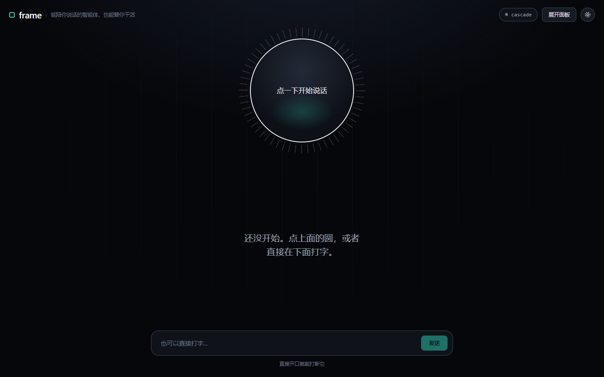
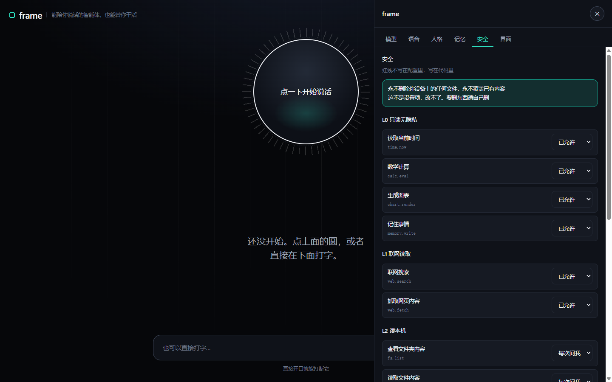

# frame

**能陪你说话的智能体，也能替你干活。**

对着麦克风说话，它实时回你。有自己的脾气，记得住你的事。需要的时候，它能真的动手 —— 查时间、算数、搜网页、读你给的链接。

用你自己的 API key。语音、人格、记忆、执行能力，全部在一个项目里，`npm run dev` 就能跑。

[](https://github.com/ghl872954-glitch/frame-ai/actions/workflows/ci.yml)
[](LICENSE)

[English](README.en.md) · [设计方案](DESIGN.md) · [架构](docs/ARCHITECTURE.md) · [隐私](docs/PRIVACY.md) · [安全策略](SECURITY.md)



---

## 它是什么

- **实时语音对话**。不用按键，直接开口；它说话时你随时能打断。
- **稳定人格**。预设几个角色，也可以自己写一套。不想要人设就关掉，退回普通助手。
- **记忆**。记住你的偏好和习惯，每一条你都能看、能删、能导出。
- **能执行任务**。查时间、算数学题、记住事情、抓网页、搜资料。分级授权，你自己决定放开到哪一级。
- **能看屏幕**。框住任意一块，或者（经你同意后）看整个屏幕、所有显示器；桌面版里，你同意后它还能替你点。
- **有桌面版**。置顶小窗 + 全局快捷键 + 能看到别的窗口；`npm run pack` 打成 exe，双击就跑。
- **用自己的 key**。10 个预设服务商，国内外都有；任何一个 OpenAI 兼容的网关都能接。
- **中英双语 + 深/浅主题**。

## 它不做什么

这不是免责声明，是写在代码里的约束。

- **永不删除你设备上的任何文件。**
- **永不覆盖已有内容** —— 写入只支持「新建」和「追加」。
- **不常驻监听，不主动搭话。** 你不开口，它不吭声。
- **不偷偷上传。** API key 只存在你自己的浏览器里。

---

## 快速开始

需要 **Node.js 20.9 或更高**。

```bash
git clone https://github.com/ghl872954-glitch/frame-ai.git
cd frame-ai
npm install
npm run dev
```

打开 http://localhost:3000 ，点右上角的圆齿轮 → **模型** 标签页：

1. 选一个服务商（国内推荐硅基流动，注册就送额度）
2. 点「去拿 key」，把 key 填回来
3. 点「测试连接」，看到「通了」就完事了

回到主界面，点中间那个圆开始说话。不想说话就直接在下面打字。

> 想完全离线？选 **Ollama（本地）**，模型跑在你自己电脑上，一个字都不出本机。

---

## 支持的服务商

| 服务商 | 地区 | 对话 | 语音识别 | 语音合成 |
| --- | --- | --- | --- | --- |
| 硅基流动 | 国内 | ✅ | ✅ | ✅ |
| DeepSeek | 国内 | ✅ | — | — |
| 阿里百炼 | 国内 | ✅ | — | — |
| 智谱 GLM | 国内 | ✅ | — | — |
| 月之暗面 Kimi | 国内 | ✅ | — | — |
| OpenAI | 海外 | ✅ | ✅ | ✅ |
| Groq | 海外 | ✅ | ✅ | — |
| OpenRouter | 海外 | ✅ | — | — |
| Ollama | 本地 | ✅ | — | — |
| 自定义 | — | ✅ | ✅ | ✅ |

「—」不代表这家用不了。看下一节。

所有字段在界面上都能改，模型名还能一键从服务商拉取 —— 各家的模型名换得比文档快，硬编码迟早过期。

---

## 为什么「模型不支持语音也能用」

这是整个项目最关键的设计。

你配的可能是 DeepSeek 这种纯文本模型。如果语音功能跟模型绑死，你就用不了语音 —— 这是大多数同类项目的做法。

frame 把语音拆成三层，各自独立可换：

```
麦克风 → VAD → STT → LLM → TTS → 扬声器
                ↑     ↑     ↑
                └─────┴─────┘
           三层独立，来源可以混搭
```

打开时自动挑当前能用的最高一档：

| 档位 | 条件 | 效果 |
| --- | --- | --- |
| ① 原生实时 | 端点支持实时语音协议 | 延迟最低 |
| ② 云端级联 | 配了云端识别和合成 | 效果最好 |
| ③ 浏览器内置 | 其他情况（默认走这档） | 零配置，Chrome / Edge 可用 |
| ④ 纯文字 | 浏览器不支持语音 | 打字聊，回答显示字幕 |

**所以哪怕你配的是纯文本模型，语音照样能用** —— 它自动落到第 ③ 档，用浏览器自己的识别和合成。

同样的思路也用在了工具调用上：不依赖原生 function calling（那样只有部分模型能用），而是把工具清单写进提示词，让模型输出约定格式的代码块。**任何模型都能执行任务。**

---

## 安全设计

「永不删除用户设备上的重要信息」这句话，靠三层叠加实现，不是一条规则。

**第一层 · 物理层**：执行器里**根本没有实现删除和覆盖的函数**。
不存在的函数，任何配置、任何授权、任何模型请求都调不到。规则可以被绕过，不存在的函数绕不过去。

**第二层 · 静态层**：一张写在代码里的正则表，命中直接拒绝，连确认弹窗都不给。
覆盖七类：删除 / 覆盖 / 提权 / 持久化 / 远程执行 / 系统破坏 / 隐私读取。
扫之前会先把引号里的内容去掉，免得误伤 `echo "rm -rf /"` 这种只是提到命令的情况。

**第三层 · 授权层**：能力分成五级，你自己决定放开到哪一级。

| 级别 | 内容 | 默认 |
| --- | --- | --- |
| L0 | 时间、计算、图表、写记忆 | 允许 |
| L1 | 联网搜索、抓网页 | 允许，可关 |
| L2 | 读本机：列目录、读文件、读剪贴板 | 首次弹窗 |
| L3 | 写本机：新建、追加、打开程序、写剪贴板 | 每次确认 |
| L4 | 执行命令、发起网络请求 | 每次确认 + 展示全文 |
| L5 | 删除、覆盖、提权、系统破坏 | **永不开放** |

红线压过一切。就算你在设置里把某个能力点成「以后都允许」，命中红线的动作照样被拒。



每次工具调用都会在「安全」标签页留一条流水：调用了什么、参数是什么、结果如何。

---

## 内置工具

| 工具 | 做什么 | 级别 |
| --- | --- | --- |
| `get_time` | 读取当前时间 | L0 |
| `calculate` | 算数学题。支持 `+ - * / % ^`、括号和 `sqrt/abs/round/min/max/log` 等函数 | L0 |
| `remember` | 记住一件关于你的事 | L0 |
| `fetch_url` | 抓网页正文 | L1 |
| `web_search` | 联网搜索 | L1 |
| `desktop_click` | 在框选的屏幕区域里替你点一下（桌面版，逐次确认） | L4 |
| `desktop_type` | 把一段文字打到光标处（桌面版，逐次确认） | L4 |

计算器是**手写的词法分析 + 递归下降解析**，刻意不用 `eval` / `new Function` —— 那是把一个任意代码执行漏洞塞进产品里。

`fetch_url` 做了 SSRF 防护：回环地址、内网段、云元数据地址（`169.254.169.254`）默认全部拦掉。本机部署时可以通过配置放开 localhost，方便连自己跑的 Ollama。

---

## 项目结构

```
frame/
├─ src/
│  ├─ app/
│  │  ├─ page.tsx            双模式主界面（极简 / 展开）
│  │  ├─ layout.tsx          元信息
│  │  ├─ icon.svg            图标：一个方框加一个点
│  │  ├─ globals.css         设计系统：深浅两套变量 + 几何母题
│  │  └─ api/                chat 代理 / 模型列表 / 抓网页 / 自检
│  ├─ components/            声场盘 / 字幕 / 输入框 / 设置面板 / 确认弹窗
│  ├─ i18n/                  中英字典（英文漏键会编译报错）
│  └─ lib/
│     ├─ voice/              降级决策 / 浏览器适配器 / 切句 / 会话状态机
│     ├─ tools/              分级授权 / 红线 / 计算器 / 协议解析 / 流式过滤
│     ├─ agent.ts            一轮对话的完整流程
│     ├─ memory.ts           三层记忆
│     └─ store.ts            全局状态
├─ tests/                    Vitest，203 个用例
├─ docs/
│  ├─ ARCHITECTURE.md        数据怎么流动、模块各管什么
│  └─ PRIVACY.md             每一类数据具体去了哪里
├─ .github/                  CI、issue 模板、PR 模板、依赖更新
├─ DESIGN.md                 完整设计方案
├─ SECURITY.md               漏洞报告渠道 + 已知取舍
└─ CONTRIBUTING.md           三条底线 + 代码风格
```

**零运行时依赖**：只有 next / react / zustand。样式是手写的 CSS 变量，没引 Tailwind。

---

## 开发

```bash
npm run dev        # 开发服务器
npm run build      # 生产构建
npm run lint       # ESLint
npm run test       # 单元测试
npm run typecheck  # 类型检查
npm run check      # lint + 类型检查 + 测试，提交前跑这个
```

测试覆盖的是最容易出错、也最该有测试的部分：降级决策、语音会话与打断、句子切分、流式工具块过滤、红线规则、计算器、协议解析、记忆去重、坏配置修正、一轮对话的完整链路。

**不需要配置任何环境变量。** API key 存在浏览器里，服务端不落盘。

---

## 常见问题

**装了依赖但 `npm test` 报找不到 `@rollup/rollup-win32-x64-msvc`**

这是 npm 的老问题（[npm/cli#4828](https://github.com/npm/cli/issues/4828)）：它偶尔会漏装可选平台依赖。
如果删掉 `node_modules` 和 `package-lock.json` 重装一次还不行，手动补一下：

```bash
npm install --no-save @rollup/rollup-win32-x64-msvc @esbuild/win32-x64
```

**点了圆没反应，或者提示拿不到麦克风**

浏览器需要麦克风权限。看地址栏左边的权限图标，把麦克风打开。另外 `localhost` 和 `https` 才允许调用麦克风 —— 用 IP 访问是不行的。

**Firefox 里语音用不了**

Firefox 没有实现 Web Speech API。换 Chrome 或 Edge，或者直接打字 —— 打字模式下所有功能都在。

**它把自己的声音当成我在说话**

外放时容易发生。戴耳机最省事，或者到「语音」标签页把「允许打断」关掉。

**连不上模型服务**

先去「模型」标签页点「测试连接」，那里会给出具体原因（key 错、余额不足、地址写错、模型名过期）。模型名可以直接点「拉取模型列表」从服务商拿真实列表。

---

## 参与开发

先看 [CONTRIBUTING.md](CONTRIBUTING.md)。里面有**三条不能碰的底线**：

1. 不加任何删除文件的功能
2. 不把红线做成可配置项
3. 不引入 `eval` / `new Function`

这三条比功能重要。违反的话 PR 不会合并，无论功能多有用。

发现安全问题（尤其是绕过红线）请走 [SECURITY.md](SECURITY.md) 里的私密报告通道，不要开公开 issue。

---

## 许可证

MIT
